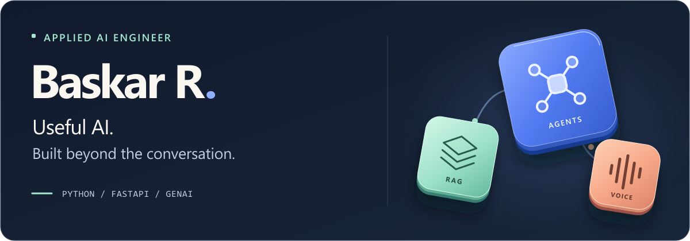

<picture>
  <source media="(max-width: 600px)" srcset="./banner-mobile.png">
  
</picture>

  <a href="https://baskar-forever.github.io/"><strong>Portfolio</strong></a> &nbsp; / &nbsp;
  <a href="https://www.linkedin.com/in/baskar-g-ceo/">LinkedIn</a> &nbsp; / &nbsp;
  <a href="mailto:baskargceo@gmail.com">Email</a>

I build **RAG assistants, AI agents, and real-time voice systems** with Python and FastAPI.

### Selected Work

- **[Omnichannel RAG](https://github.com/Baskar-forever/omnichannel-rag-chatbot)**: hybrid retrieval for website and WhatsApp conversations.
- **[SareeBot AI](https://baskar-forever.github.io/projects/sareebot.html)**: voice commerce connecting calls, inventory, orders, and payments.
- **[ResumeAI](https://resumeai.works/)**: resume tailoring, document extraction, and PDF generation.

**Stack:** Python / FastAPI / LangChain / CrewAI / PostgreSQL / Docker

Based in Salem, India. Open to **Applied AI and GenAI engineering opportunities**.
